# Medallion no Databricks com preços de combustíveis da ANP

Pipeline de engenharia de dados do arquivo bruto ao dashboard. Os dados abertos da ANP passam por ingestão incremental, limpeza com regras de qualidade, modelagem analítica e visualização, tudo no Databricks Free Edition e com custo zero.

O projeto foi reconstruído do zero a partir deste repositório e chegou aos mesmos números da primeira construção.

## Resultado em números

| Item | Valor |
|---|---|
| Arquivos de origem | 6 CSVs semestrais, 2023 a 2025, cerca de 444 MB |
| Linhas na bronze | 2.616.267 |
| Linhas na silver | 2.607.139 |
| Descartes | 9.114 linhas vazias e 14 duplicatas |
| Tamanho da silver | cerca de 37 MiB, aproximadamente 11 vezes menor que os CSVs |
| Testes do dbt | 25 de 25 passando |
| Job completo | cerca de 2,5 minutos |
| Custo | US$ 0 |

## Arquitetura

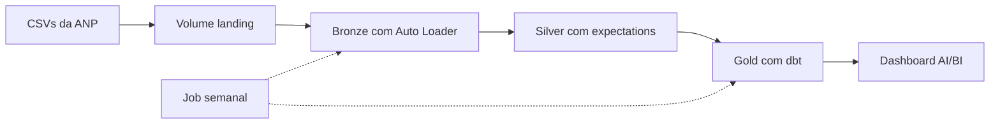

| Camada | Tabela | Função |
|---|---|---|
| Landing | `/Volumes/gas_medallion/landing/raw/anp/` | Arquivos brutos sem alteração |
| Bronze | `bronze_combustiveis` | Dado cru em texto, colunas em snake_case, arquivo de origem e hora de ingestão |
| Silver | `silver_combustiveis` | Dado tipado, validado e sem duplicatas |
| Gold | `preco_medio_estado_mes`, `ranking_municipios`, `variacao_semanal` | Modelos analíticos prontos para consumo |

Stack usada: Unity Catalog, Volumes, Auto Loader, Lakeflow Declarative Pipelines, dbt-databricks, Databricks Jobs, Databricks Asset Bundles e AI/BI Dashboards.

## Pipeline em execução

O grafo abaixo mostra a execução criada pelo Asset Bundle, com bronze, a view de validação e a silver.

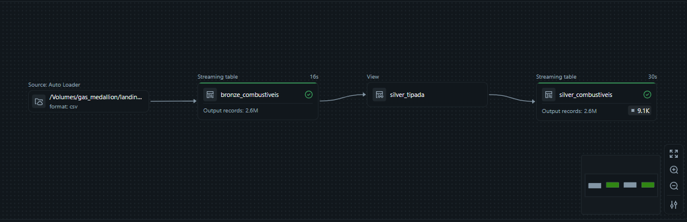

O job tem duas tarefas. A primeira roda o pipeline e a segunda roda o dbt.

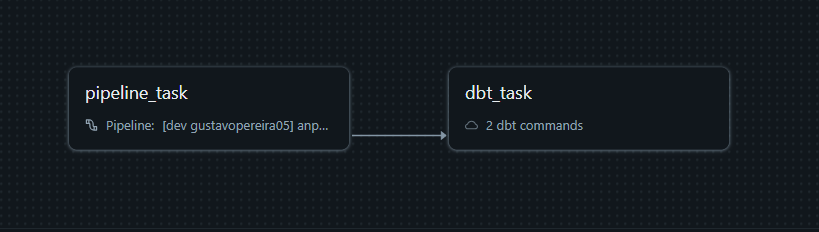

## Ingestão incremental

Os quatro primeiros semestres entraram na carga inicial. Os dois semestres de 2025 foram enviados depois, um de cada vez, com execução normal e sem full refresh. A segunda execução processou apenas 430 mil linhas, o tamanho do arquivo novo, e não os dois milhões já existentes.

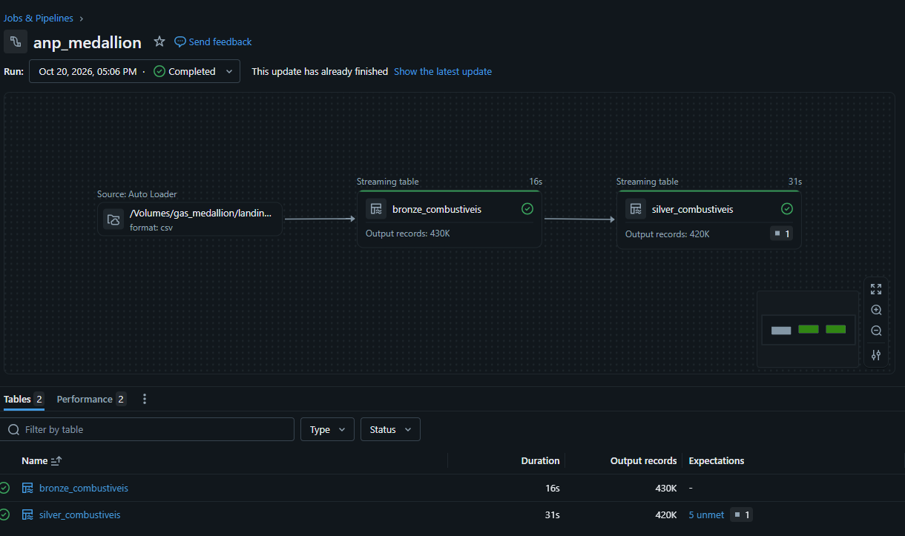

| Arquivo | Linhas na bronze |
|---|---|
| 2023 semestre 1 | 431.576 |
| 2023 semestre 2 | 472.424 |
| 2024 semestre 1 | 477.154 |
| 2024 semestre 2 | 421.382 |
| 2025 semestre 1 | 429.523 |
| 2025 semestre 2 | 384.208 |

## Qualidade de dados

A silver aplica seis regras declarativas. As regras de descarte tiram a linha da tabela. As de registro apenas contam a violação.

| Regra | Condição | Ação |
|---|---|---|
| `estado_preenchido` | estado não nulo | registra |
| `unidade_preenchida` | unidade não nula | registra |
| `unidade_conhecida` | unidade igual a R$ / litro ou R$ / m³ | registra |
| `preco_valido` | preço maior que 0 e menor que 20 | descarta |
| `data_valida` | data não nula | descarta |
| `cnpj_valido` | CNPJ com 14 dígitos | descarta |

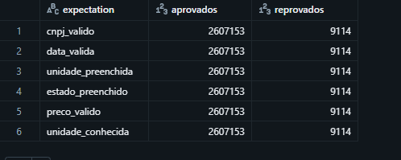

Cada regra reprova 9.114 linhas. São as mesmas linhas vazias contadas em todas as regras, e não nove mil problemas diferentes.

A tabela abaixo separa as execuções. O primeiro grupo mostra o reprocessamento da silver depois da refatoração, com as 9.114 reprovações. O segundo mostra a carga do 2025 semestre 2, que chegou limpa.

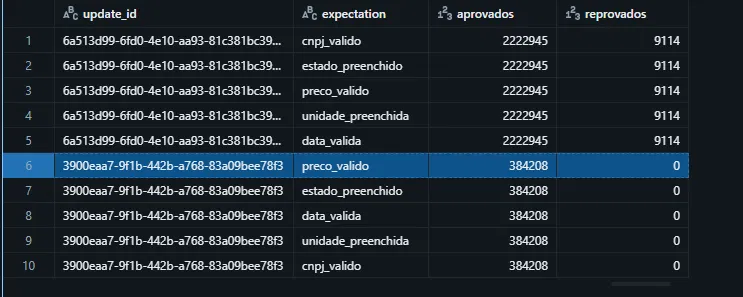

## Problemas reais encontrados

### Linhas vazias no arquivo de 2025 semestre 1

O arquivo trouxe 9.114 linhas sem dados. Na primeira versão da silver a deduplicação rodava antes das regras e juntava todas em uma só, então o relatório mostrava apenas uma reprovação. A correção foi separar a silver em dois passos. Uma view aplica a tipagem e as regras, e a tabela final aplica a deduplicação. Depois disso o relatório passou a mostrar as 9.114 reprovações. A causa das linhas vazias não foi verificada no arquivo bruto.

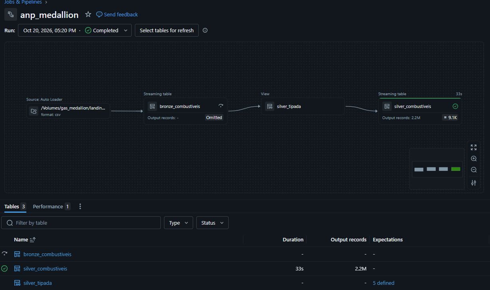

### Troca de unidade do GNV

A ANP trocou a unidade do GNV de `R$ / m³` para `R$ / m3` em 01/07/2025, na virada entre os dois arquivos de 2025. A silver não percebeu porque a única regra sobre unidade testava apenas valor nulo. Quem detectou foi um teste de unicidade do dbt, que falhou no gold. A correção foi padronizar a unidade na silver, manter o valor original na bronze, criar a regra `unidade_conhecida` e testar a unidade na origem do dbt. O GNV ficou com 55.672 linhas e uma única unidade.

### Soma indevida no gráfico do GNV

A primeira versão do gráfico do GNV mostrava preços entre R$ 79 e R$ 95 por m³. A consulta devolvia uma linha por estado e mês, e o gráfico somava os estados. A correção foi agregar na própria consulta com média ponderada pelo número de coletas. O erro apareceu ao revisar o print e o gráfico passou a mostrar valores entre R$ 4,5 e R$ 4,9.

### Encoding

A hipótese inicial era ISO-8859-1, comum em dados da ANP. A leitura falhou com essa opção e funcionou sem ela. Os arquivos são UTF-8.

## Gold com dbt

| Modelo | Granularidade | Observação |
|---|---|---|
| `preco_medio_estado_mes` | estado, produto e mês | Inclui `familia_produto` para juntar gasolina com aditivada e diesel com S10 |
| `ranking_municipios` | estado, município e produto | Exige no mínimo 30 coletas por município |
| `variacao_semanal` | produto e semana | Só calcula variação com semana anterior consecutiva |

São 22 testes de dados somados aos 3 modelos, com resultado de 25 de 25. Os testes cobrem valores aceitos, nulos, unicidade da chave e uma faixa plausível de preço médio. Oito deles ficam na origem e conferem a própria silver.

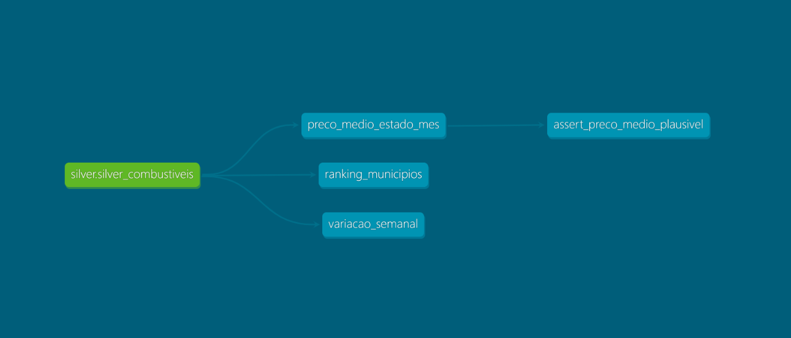

## Delta Lake

Cada execução do dbt cria uma nova versão da tabela gold e o histórico é preservado. A versão 0 foi gerada antes da correção do GNV e ainda mostra as duas unidades. A versão 4 mostra só `R$ / m³`. O time travel guardou a evidência do problema.

A silver ocupa um único arquivo de 37 MiB. O OPTIMIZE não encontrou nada para compactar na gold. O VACUUM em modo de teste não listou arquivos, provavelmente porque tudo ainda está dentro do prazo de retenção. O detalhamento está em [docs/delta.md](docs/delta.md).

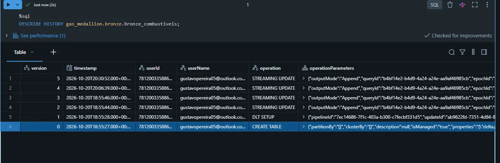

## Dashboard

Os gráficos de preço leem as tabelas gold. O bloco de qualidade consulta a bronze, a silver e as métricas das expectations. O preço médio nacional é ponderado pelo número de coletas de cada estado. O GNV aparece em gráfico próprio porque a unidade é diferente e também usa média ponderada.

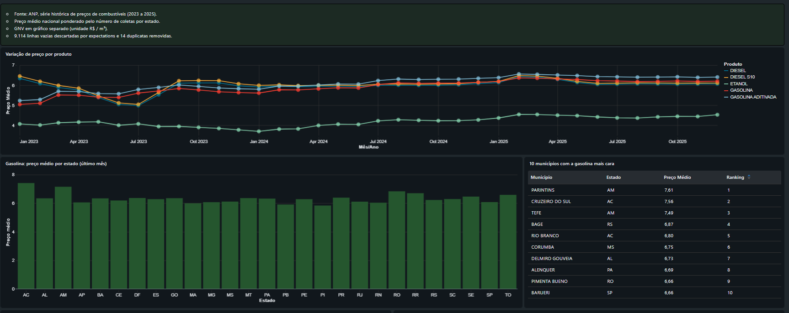

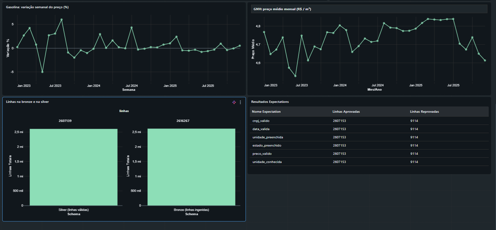

## Principais decisões

| Decisão | Ganho | Custo |
|---|---|---|
| Bronze com tudo em texto | O pipeline nunca falha por tipo e os erros aparecem na silver | Consultas na bronze exigem conversão |
| Regras de qualidade antes da deduplicação | O relatório mostra tudo o que entrou | Mais um objeto no grafo |
| Unidade padronizada na silver | Gold consistente e bronze preservada | Lista de unidades aceitas é fixa |
| dbt só para o gold | Testes, documentação e linhagem declarativos | Duas ferramentas para orquestrar |
| Asset Bundle no lugar do pipeline criado pela UI | Infraestrutura versionada e reproduzível | O histórico incremental da bronze foi perdido na troca |
| Job com agendamento pausado | Não consome a cota gratuita | Roda sob demanda |

O registro completo, com prós e contras de cada decisão, está em [docs/decisoes_tecnicas.md](docs/decisoes_tecnicas.md).

## Limitações conhecidas

- O time travel por `VERSION AS OF` falhou na streaming table da bronze. A causa não foi confirmada e a demonstração usa a gold.
- Em 4 das 14 duplicatas os preços divergem e a deduplicação mantém uma linha arbitrária. O impacto é desprezível.
- O mínimo de 30 coletas no ranking é um valor escolhido sem calibração.
- O catálogo é variável do bundle, mas o código do pipeline ainda usa `gas_medallion` fixo.
- O job busca o projeto dbt na branch main do GitHub. Código sem push não roda.
- Em redes que inspecionam HTTPS pode ser preciso instalar `pip-system-certs` para o dbt local.

## Estrutura do repositório

```
databricks.yml          configuração do bundle
resources/              pipeline e job
src/pipeline/           bronze.py e silver.py
dbt_combustiveis/       modelos, testes e fontes do dbt
docs/                   imagens, delta.md e decisoes_tecnicas.md
requirements.txt        dependências do dbt local
```

Os dados brutos ficam fora do Git.

## Status

Todas as fases do plano foram concluídas. São elas a preparação do ambiente, a landing, a bronze, a silver, a ingestão incremental, o gold com dbt, a orquestração com Asset Bundle e o dashboard.
